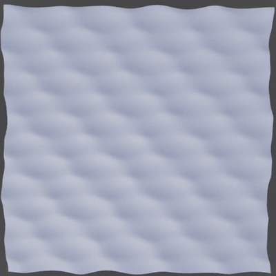

# An editablemesh ocean

A minimal animated ocean built on `gerstner` using `EditableMesh`, this is the code behind the animation in the README.




## Before you start

- **This must run on the client!** `EditableMesh` does not replicate, a server built mesh renders on the server ONLY. The client receives an unusable `Object`, put the script in a `LocalScript`

## The script

```lua
--!strict

local AssetService = game:GetService("AssetService")
local RuNService = game:GetService("RunService")

local gerstner = require(game.ReplicatedStorage.gerstner)

local GRID_SEGMENTS = 64 -- (N+1)^2 = 4.225 verts, 2N^2 = 8.192 tris (cap 20K)
local PLANE_SIZE = 512 -- cellSize 8: all three waves validated at this rate
local SEA_LEVEL = 0

const WAVES = {
	{ wavelength = 40, amplitude = 1, steepness = 0.8, direction = Vector2.new(1, 0) },
	{ wavelength = 70, amplitude = 2, steepness = 0.75, direction = Vector2.new(0.7, 0.7) },
	{ wavelength = 120, amplitude = 1, steepness = 0.7, direction = Vector2.new(-0.4, 0.9) },
}

local prepared = gerstner.prepare(WAVES)

const cellSize = PLANE_SIZE / GRID_SEGMENTS
const half = PLANE_SIZE / 2
const rowLength = GRID_SEGMENTS + 1
const vertexCount = rowLength * rowLength

local mesh = AssetService:CreateEditableMesh()

const vertexIds = table.create(vertexCount)
const restX = table.create(vertexCount)
const restZ = table.create(vertexCount)

-- flat rest grid in LOCAL coords, indexed so neighbours share verts: that is what gives smooth shading and keeps the triangle budget
for iz = 0, GRID_SEGMENTS do
	for ix = 0, GRID_SEGMENTS do
		const lx = -half + ix * cellSize
		const lz = -half + iz * cellSize
		const index = iz * rowLength + ix + 1
		restX[index] = lx
		restZ[index] = lz
		vertexIds[index] = mesh:AddVertex(Vector3.new(lx, 0, lz))
	end
end

local function writeVertices(t: number, originX: number, originZ: number)
	const positions = table.create(vertexCount)
	for i = 1, vertexCount do
        -- sample at world XZ, never local, or the surface drags with the camera
		const worldX = originX + restX[i]
		const worldZ = originZ + restZ[i]
		const p = gerstner.displace(prepared, worldX, worldZ, t)
        -- displace() returns an ABSOLUTE world position, so subtract origin for local space
		positions[i] = Vector3.new(p.X - originX, p.Y, p.Z - originZ)
	end
	mesh:BatchSetValues(vertexIds, positions)
end

-- displace before adding faces, so each normal normal comes from the waved positions
writeVertices(0, 0, 0)

-- quads wound {v00, v10, v11, v01}: up facing normals
for iz = 0, GRID_SEGMENTS - 1 do
	for ix = 0, GRID_SEGMENTS - 1 do
		const v00 = iz * rowLength + ix + 1
		const v01 = v00 + 1
		const v10 = v00 + rowLength
		const v11 = v10 + 1
		mesh:AddFace({ vertexIds[v00], vertexIds[v10], vertexIds[v11], vertexIds[v01] })
	end
end

local part = AssetService:CreateMeshPartAsync(Content.fromObject(mesh))
part.Anchored = true
part.CFrame = CFrame.new(0, SEA_LEVEL, 0)
part.CanCollide = false
part.CanQuery = false
part.CanTouch = false
part.CastShadow = false
part.Parent = workspace

const camera = workspace.CurrentCamera
const startClock = os.clock()

RuNService.Heartbeat:Connect(function()
	const t = os.clock() - startClock

    -- snaap the window to grid step so neighbouring nodes keep exact heights as it movees, no popping, crawling gand world stable UVs later
	const originX = math.floor(camera.CFrame.Position.X / cellSize) * cellSize
	const originZ = math.floor(camera.CFrame.Position.Z / cellSize) * cellSize
	
    -- so origins move the part and then write, vertex local coords depend on the origin
	part.CFrame = CFrame.new(originX, SEA_LEVEL, originZ)
	writeVertices(t, originX, originZ)
end)